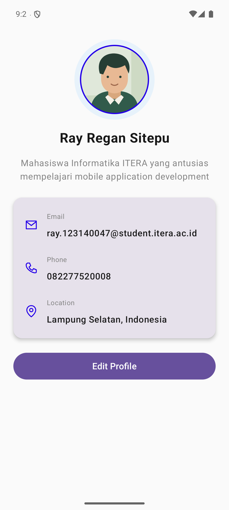
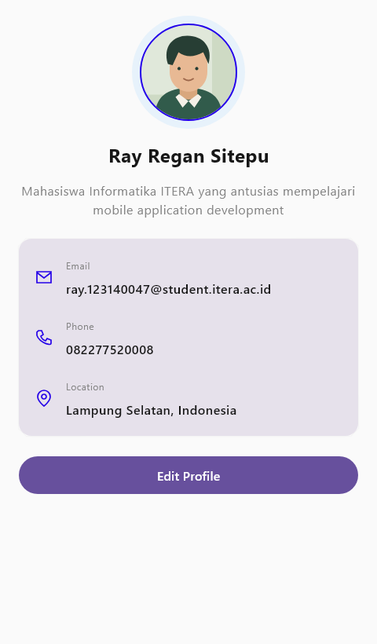

# My Profile App

Tugas Praktikum Minggu 3 - Compose Multiplatform Basics, Pengembangan Aplikasi Mobile ITERA.

**Nama:** Ray Regan Sitepu  
**NIM:** 123140047  
**Email:** ray.123140047@student.itera.ac.id

## Fitur

- Avatar melingkar, nama, dan bio.
- Kartu berisi email, telepon, dan lokasi.
- Edit profil dengan validasi nama dan email.
- Animasi `AnimatedVisibility` saat kartu kontak muncul.
- Satu kode UI untuk Android dan Desktop, dengan halaman yang dapat digulir.

## Screenshot

| Android (Pixel 8) | Desktop |
| --- | --- |
|  |  |

Screenshot Android diambil langsung dari emulator. Screenshot Desktop dihasilkan dari UI Compose melalui pengujian Skiko.

## Menjalankan

Gunakan JDK 21 dan Android SDK 37. Untuk Android Studio, salin/ekstrak proyek ke folder tanpa koma, misalnya `D:\MyProfileApp`, lalu buka proyek dan jalankan modul `androidApp`.

Dari PowerShell:

```powershell
# Jalankan Desktop
.\run.ps1 :desktopApp:run

# Build APK Android
.\run.ps1 :androidApp:assembleDebug

# Jalankan pengujian UI
.\run.ps1 :desktopApp:test
```

`run.ps1` mengatasi tanda koma pada path Windows dengan alias drive sementara. Pada folder tanpa koma dapat menggunakan `gradlew.bat` langsung; macOS/Linux memakai `./gradlew`.

APK: `androidApp/build/outputs/apk/debug/androidApp-debug.apk`.

## Kode dan ketentuan tugas

| Bagian | Implementasi |
| --- | --- |
| UI bersama | `shared/src/commonMain/kotlin/com/itera/myprofile/App.kt` |
| Data profil | `shared/src/commonMain/kotlin/com/itera/myprofile/Profile.kt` |
| 3 composable reusable | `ProfileHeader`, `ProfileCard`, `InfoItem` |
| Layout wajib | `Column`, `Row`, `Box` |
| Komponen wajib | `Card`, `Text`, `Button`, `Image`, `Icon` |
| Styling | `Modifier` untuk ukuran, padding, border, clip, background, dan scroll |
| Bonus | `AnimatedVisibility` pada kartu kontak |
| Entry point | `androidApp` dan `desktopApp` |

Untuk mengganti foto, tambahkan `profile_photo.jpg` ke `shared/src/commonMain/composeResources/drawable/`, lalu ganti import resource `avatar` dan `Res.drawable.avatar` di `App.kt` menjadi `profile_photo` dan `Res.drawable.profile_photo`.

## Verifikasi dan pengumpulan

Build Android berhasil dan tiga pengujian Desktop lulus: tampilan profil, validasi/simpan/batal edit, dan scroll layar sempit. Aplikasi juga berhasil dibuka pada emulator Pixel 8 (API 35).

Avatar masih ilustrasi. Edit profil berlaku selama aplikasi terbuka; ubah `Profile.kt` untuk mengganti data awal secara permanen.

Push kode, README, dan screenshot ke repository tugas sebelumnya sebelum Pertemuan 4. Jangan sertakan `local.properties`, `.gradle`, atau folder `build`. Proyek belum di-push ke GitHub.
